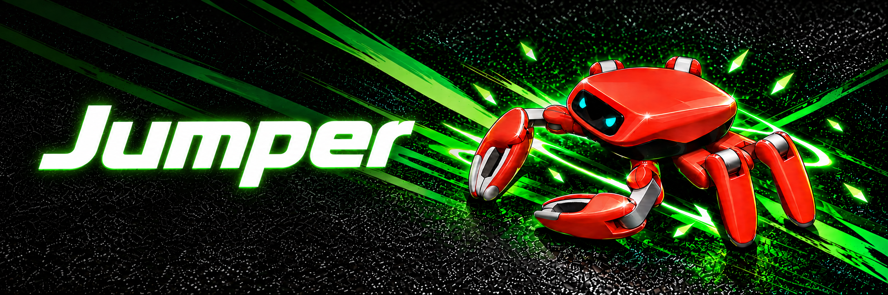

# Jumper Agent

**English** | [简体中文](README.zh.md)

> **Project lineage:** This repository is a GitHub fork of
> [KingKongRobotics/jumper](https://github.com/KingKongRobotics/jumper). Its active project
> branch is \`jumper-agent\`, which keeps the robot-training and MuJoCo simulation foundation
> and adds the Tiaotiao browser face, dual-screen mirroring, and local AI action control.

Jumper Agent brings the robot model, motion tools, simulator, browser eyes, and desktop
screen-casting workflow together in one repository. The repository is
[AugustSama-GEEKDOM/jumper-agent](https://github.com/AugustSama-GEEKDOM/jumper-agent).

## What is included

- A 22-joint Jumper model, MuJoCo scenes, locomotion and motion tasks, training, replay,
  policy export, and controller bundles.
- A policy-driven desktop simulator. Its model has two circular, render-only screens sized
  to match the robot's 0.9-inch displays.
- A Windows GUI for selecting two circular areas of the desktop and streaming them into the
  simulator screens.
- The Tiaotiao browser face, with animated expressions, voice interaction, weather and music
  views, plus a browser-to-simulator face sync.
- An optional AI action queue. It can execute bounded movement and built-in motions in
  sequence and show progress in the browser.

Screen mirroring is for the simulator display textures; it does not add a camera observation
or a hardware display transport. The AI action bridge is local simulator control, not a robot
hardware API.

## Start the integrated Windows demo

The integrated launcher expects Windows 10/11, Python 3.11 at the standard per-user install
location, Node.js 18 or newer, Microsoft Edge, and a usable example bundle under
the repository's out directory. Install the Python dependencies into the same Python 3.11
installation that the launcher uses:

~~~powershell
$python = Join-Path $env:LOCALAPPDATA 'Programs\Python\Python311\python.exe'
& $python -m pip install -e '.[screen-mirror]'
.\start-tiaotiao-web-simulator.ps1
~~~

The browser opens on the local web app. The launcher starts the simulator and the screen-cast
window as well. Use the GUI to enter the source-circle diameter, select the two screen areas,
and start desktop mirroring. See the [integrated demo guide](docs/TIAOTIAO_DEVELOPMENT.md) for
configuration, controls, and troubleshooting.

## Train or replay a motion

Create an environment appropriate for your CPU or NVIDIA GPU, then install this checkout:

~~~bash
python -m venv .venv
python -m pip install -e '.[dev]'
python scripts/train.py --list
python scripts/play.py --task jumper.tripod
~~~

See the [project guide](docs/PROJECT_GUIDE.md) for setup routes and the
[development guide](docs/DEVELOPMENT.md) for repository structure and validation.

## Documentation

| Guide | What it covers |
|---|---|
| [Project guide](docs/PROJECT_GUIDE.md) | Getting started, main project areas, and choosing a workflow |
| [Development guide](docs/DEVELOPMENT.md) | Architecture, local checks, packaging, and contribution flow |
| [Web and simulator guide](docs/TIAOTIAO_DEVELOPMENT.md) | Browser face, screen capture, action queue, and Windows launcher |
| [Screen mirroring details](docs/SCREEN_MIRROR.md) | Display geometry, stream formats, and simulator receiver |
| [Training usage](docs/USAGE.md) | Training commands, tasks, assets, and configuration |
| [Deployment](deploy/README.md) | Exported controller bundles and the hardware path |

## License and notices

Project-owned material is covered by [LICENSE](LICENSE). Review [NOTICE](NOTICE) for
third-party components and media. A derived output does not automatically inherit the
repository's license.
