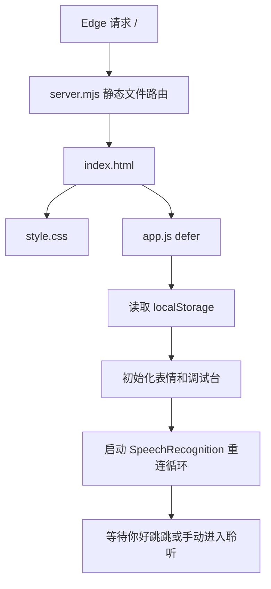
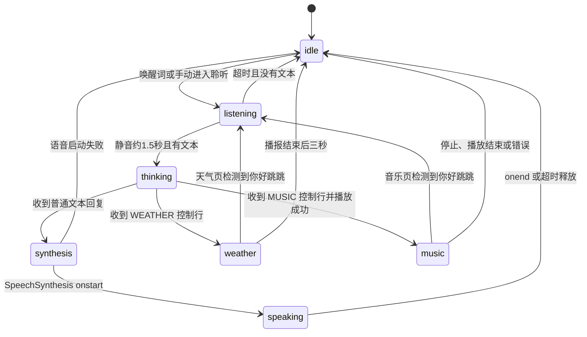
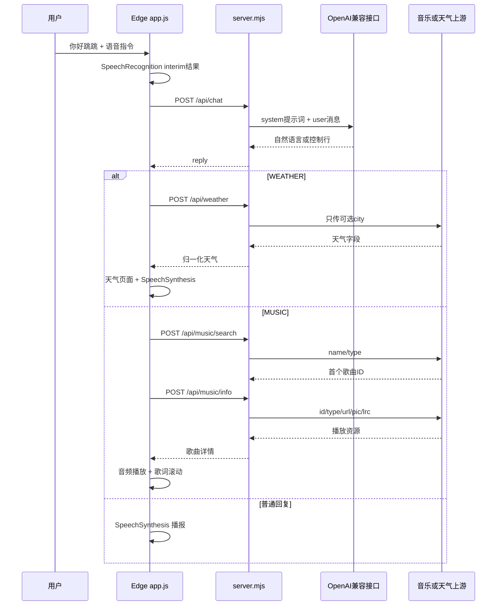

# 程序代码详解

这份文档按运行时顺序解释主应用的代码。行号会随着后续修改变化，因此以函数名和选择器为主要定位方式；在编辑器中搜索函数名即可跳到实现位置。

## 1. 请求进入页面后的执行顺序

`server.mjs` 只负责本地 HTTP 服务和上游代理，浏览器端的 `app.js` 负责 UI、语音和状态。CSS 动画不会阻塞语音请求；网络请求期间 SVG 眼睛仍可通过 `data-state` 选择器显示思考或等待动画。

## 2. `index.html`：页面结构

### 根容器

`main#eye-display` 是所有可见内容的定位上下文，拥有 `tabindex="0"`，因此可以获得焦点并响应键盘表情预览。根容器的 class 会在运行时追加 `music-mode` 或 `weather-mode`，用于控制主眼睛与媒体界面的淡入淡出。

### SVG 眼睛

`svg#eye-stage` 是主显示层，内部结构如下：

| 节点 | 作用 |
| --- | --- |
| `#gaze` | 统一平移左右眼，模拟注视方向 |
| `.eye-group` | 每只眼的缩放和中心位置 |
| `#left-eye`、`#right-eye` | 用 SVG `path` 描述眼睛曲线 |
| `#eye-effects` | 问号、加载圆环和星星等特效 |
| `data-state` | 当前运行状态，如 `idle`、`listening`、`thinking` |
| `data-expression` | 当前表情，如 `wink`、`question`、`happy` |

眼睛不是图片。`app.js` 会持续改写两个 path 的 `d` 属性和 `stroke-width`，所以缩放、颜色和过渡都保持矢量清晰度。

### 天气、音乐和调试区

- `#weather-view`：左侧天气图标，右侧地点、温度和天气详情。
- `#music-view`：左侧封面圆盘，右侧单行歌词；圆形容器隐藏溢出内容。
- `#debug-panel`：状态网格、进度条、模型名、背景色、手动聆听、表情预览和手动搜歌。
- `#music-audio`：没有可见控件的 HTMLAudioElement，由音乐逻辑设置 `src`、播放、暂停和监听事件。

## 3. `style.css`：视觉层和响应式布局

### 主题变量

`:root` 定义 `--page-background` 和 `--eye-color`。背景色设置会把新颜色写入 `--page-background`，因此 `html`、`body`、`.eye-display` 和 SVG 周围的所有黑色区域会同步变化。

### 眼睛路径

`#left-eye, #right-eye` 使用无填充、圆角线帽和淡蓝色描边。`transform-box: fill-box` 与 `transform-origin: center` 让 CSS 的上下缩放动画围绕每只眼自身中心进行，避免出现右眼倾斜或跳动。

### 状态动画

| CSS 选择器 | 视觉反馈 |
| --- | --- |
| `#eye-stage[data-state="idle"]` | 呼吸式淡光和待机微动 |
| `#eye-stage[data-state="listening"]` | 更亮的光晕和聆听问号 |
| `#eye-stage[data-state="thinking"]` | 眼睛注视偏移和右上角加载圆环 |
| `#eye-stage[data-state="synthesis"]` | 语音准备脉冲 |
| `#eye-stage[data-state="speaking"]` | 播报时上下弹性变化 |
| `[data-expression="wink"] #effect-stars` | 眨眼时显示星星 |
| `[data-expression="question"] #effect-question` | 疑问表情显示摇摆问号 |

媒体页面使用 `opacity`、`transform` 和 `pointer-events` 过渡。`@media (max-width: 620px)` 和 `@media (max-width: 380px)` 会减少调试台间距、切换按钮网格列数并缩小圆形媒体区域。

## 4. `app.js`：数据和状态

### 初始化常量

- `display`、`stage`、`musicView`、`weatherView` 等 DOM 引用只在脚本加载时查询一次。
- `debugFields` 把每个调试字段映射到 DOM，`setDebug()` 统一更新文字和进度条。
- `Recognition` 从 `window.SpeechRecognition` 或 `window.webkitSpeechRecognition` 中选择 Edge 实现。
- `speechEngine` 指向 `window.speechSynthesis`；不存在时页面仍可显示表情，但会将 TTS 标记为不支持。
- defaultModelName 为空；模型输入框不会预填公开默认值。

### 表情数据

`shapes` 是基本眼形字典。每个 shape 包含 14 个路径控制点坐标 `p` 和描边宽度 `w`。`moods` 把用户可见的表情名映射到左右眼 shape，例如 `wink: ['happy', 'wink']`。

新增眼形时必须保持控制点数量和顺序一致，否则 `showExpression()` 的逐点插值会出现 `NaN` 或路径跳变。新增表情后还要在 `index.html` 增加 `data-expression` 按钮，或者在 `previewMoods` 中加入键盘映射。

### 表情和注视函数

#### `renderEye(path, shape)`

把 `shape.p` 分割为起点、两段三次贝塞尔曲线和终点，生成 `M x y C ... C ...` 路径，并设置线宽。它是唯一直接写眼睛 `d` 属性的函数。

#### `showExpression(name, duration)`

1. 从 `moods` 找到目标左右眼形状。
2. 读取 `currentEyes` 作为动画起点。
3. 用 `requestAnimationFrame` 计算归一化进度。
4. 使用 `1 - (1 - progress) ** 3` 做缓出插值。
5. 每帧调用 `renderEye()`。

动画中途再次调用时会取消旧的 `eyeAnimation`，从当前曲线接续，避免表情切换闪断。

#### `lookAt(x, y, duration)`

插值更新 `#gaze` 的 `translate(x y)`。`idleLook()` 在待机状态随机选取小范围坐标；思考和聆听状态由 `setState()` 提供固定偏移或由 `updateGazeWander()` 周期变化。

#### `sizeEyesForViewport()`

根据调试台顶部位置计算可用眼睛区域，动态设置 SVG `viewBox`、左右眼中心、缩放倍率和特效锚点。这是修复右眼大小、倾斜和不同窗口尺寸显示不一致的关键函数。

### 状态机

`state` 是表情状态，`mode` 是语音收集/处理模式。两者有意分开：例如 `mode='command'` 时 `state='listening'`；`mode='processing'` 时 `state='thinking'`。

### 语音识别状态

识别实例设置 `lang='zh-CN'`、`continuous=true`、`interimResults=true` 和 `maxAlternatives=1`。

1. `scheduleRecognition()` 清理旧定时器，避免重复 start。
2. `startRecognition()` 处理 `InvalidStateError`，失败后指数式增加重试间隔。
3. `onstart` 清空当前识别会话，按当前 mode 更新调试台。
4. `onresult` 合并所有结果文本，使用 `WAKE_WORDS` 匹配“你好、您好、嗨或嘿 + 跳跳”。
5. 唤醒后 `startWakeCommand()` 记录指令起点；`updateCommand()` 每次 interim result 都重置静音计时器。
6. `finishCommand()` 在静音窗口结束后提交一轮 AI 请求。
7. `onend` 自动安排下一次识别，保证持续监听。

音乐或天气页检测到唤醒词时，先调用 `leaveMusicPage()` 或 `leaveWeatherPage()`，然后仍然走 `startWakeCommand()`，所以不会回到待机后再次等待唤醒。`interruptedAssistantRun` 用来阻止已经结束中的旧异步请求在 finally 阶段覆盖新的聆听状态。

### 手动进入聆听

`enterManualListening()` 是调试台按钮的入口。它会取消播报、退出音乐或天气页面、清空静音计时器、把 `mode` 设为 `command`、把 `commandOffset` 放到当前会话末尾，并立即调用 `setState('listening')`。因此按钮不需要伪造 SpeechRecognition 的唤醒词结果。

### 语音合成

`chooseVoice()` 优先查找完整名称 `Microsoft Yunxia Online (Natural)`，再查找 Yunxia、中文 `zh-CN` 和浏览器默认声音。`waitForVoices()` 同时监听 `voiceschanged` 和超时，避免某些 Edge 版本没有立即返回音色列表。

`synthesizeAndPlay()` 的生命周期：

1. 创建 `SpeechSynthesisUtterance` 并设置语言、音色和语速。
2. `onstart` 把状态切为 `speaking`，启动按时长估算的进度计时器和安全 watchdog。
3. `onboundary` 存在时按字符索引更新精确进度。
4. `onend` 把进度设为 100 并释放 Promise。
5. `onerror` 或 watchdog 超时会取消合成并释放状态，避免卡在“播报中”。

`sanitizePlainSpeech()` 会先移除 MUSIC/WEATHER 控制行，再清理 Markdown、代码围栏和不适合语音朗读的格式字符。因此控制行不会被 TTS 播报。

### AI 回复和控制行

`askAssistant(text)` 只发送一轮 `POST /api/chat`。返回后按顺序执行：

1. `parseWeatherCommand()` 查找 WEATHER 控制行并移除它。
2. `parseMusicCommand()` 查找 MUSIC 控制行并移除它。
3. `sanitizePlainSpeech()` 清理剩余自然语言。
4. 天气请求调用 `queryWeather()`；音乐请求调用 `playMusicByQuery()`；普通回复调用 `speakReply()`。

这样做的重点是“控制内容”和“播报内容”分离。自然语言可以被朗读，机器控制行只被浏览器解析。

### 天气模块

- `weatherKind()` 将天气文本或图标编号归类为 sunny、cloudy、rainy、snowy、stormy、foggy。
- `renderWeather()` 只把已归一化字段写入 DOM，并将详情拆成安全的文本节点。
- `enterWeatherPage()` 设置 `weather-mode`、`weatherPageActive` 和 `state='weather'`。
- `queryWeather()` 调用本地 `/api/weather`，构造短播报句子，播报结束后 `scheduleWeatherExit()` 延迟约三秒退出。

### 音乐模块

- `parseLyrics()` 解析 `[mm:ss.xx]文字` 行并按时间排序。
- `updateMusicLyric()` 根据 `musicAudio.currentTime` 找到当前歌词。
- `refreshMusicLyricScroll()` 测量单行歌词是否溢出，动态设置横向滚动距离和时长。
- `playMusicByQuery()` 只做一次搜索，取第一个结果的 ID，再请求歌曲详情；获得 MP3、封面和歌词后进入播放页。
- `enterMusicPage()` 填充歌曲信息并加入 `music-mode`；`leaveMusicPage()` 终止音频、清理当前歌曲并淡出页面。

### 调试台和背景色

setDebug() 统一更新调试信息。背景预设存储在 tiaotiao-background-color；模型名称只存储在当前浏览器的 tiaotiao-model-name-v2 项中，空值保持为空。

## 5. `server.mjs`：服务端代码详解

### 配置加载

loadLocalEnv() 读取项目根目录 .env 中的 KEY=value 行。AI 配置变量为 OPENAI_API_URL、OPENAI_API_KEY、OPENAI_MODEL；音乐配置变量为 MYHKW_MUSIC_KEY，服务端端口为 PORT。公开示例不填写 AI 地址或默认模型。

### HTTP 层

- `sendJson(response, status, value)` 统一 JSON 编码、`no-store` 和类型头。
- `setSecurityHeaders(response)` 设置 CSP、麦克风权限策略、Referrer Policy 和 nosniff。
- `readBody(request)` 限制请求体约 48 KB，并解析 JSON。
- `normalizeMessages(input)` 限制对话角色、消息数和单条长度。

### 对话代理

POST /api/chat 校验本地 AI 密钥、接口地址和请求格式；普通聊天还要求提供模型名称。纯动作指令可本地确认，不调用上游服务。其他消息才会把系统提示词和对话内容发送到本地 OPENAI_API_URL 指定的兼容接口。

如果模型忘记输出控制行，`ensureWeatherCommand()` 和 `ensureMusicCommand()` 根据用户原话补全一条控制行；`ensureActionReply()` 在服务端再次保证动作指令只得到简短确认。这样前端即使遇到模型格式偏差，也能保持解析协议。

### 音乐代理

`requestMusicApi()` 把服务端密钥、分页、平台类型和 `format/pic/url/lrc` 参数拼入上游 URL，并统一超时。`handleMusicSearch()` 只返回前端需要的 ID、平台、名称、歌手、专辑和封面；`handleMusicInfo()` 只返回歌曲 URL、封面和 LRC 等详情，避免把上游原始响应直接暴露给页面。

### 天气代理

`handleWeather()` 接受可选的 `city`，为空时不传 city 参数，指定时才加入查询参数。它检查上游响应是对象且至少有天气或温度字段，然后只返回白名单字段。天气接口失败会转成不包含上游内部细节的中文错误。

### 静态文件

`files` 显式列出允许访问的根页面、CSS、前端脚本和 favicon。未知路径返回 404；静态资源使用 `no-cache`，便于开发时刷新看到修改。

## 6. 运行时序列示例

## 7. 函数索引（按源码职责分组）

这一节覆盖主程序与服务端的具名函数，方便从报错或功能入口快速定位实现。前面章节给出其内部步骤，这里列出每个函数的输入、返回值和主要副作用。

### `app.js`：显示与通用 UI

| 函数 | 输入 | 行为、返回或副作用 |
| --- | --- | --- |
| `renderEye` | SVG path、shape | 构造贝塞尔曲线路径并设置线宽。 |
| `showExpression` | 表情名、时长 | 更新 `data-expression`，用 rAF 插值左右眼；无显式返回值。 |
| `updateGazeWander` | 可选表情名 | 清理旧注视定时器；思考、聆听或疑问时启动随机扫视。 |
| `lookAt` | x、y、时长 | 平滑更新 gaze 的 SVG 平移。 |
| `sizeEyesForViewport` | 无 | 根据屏幕和调试台尺寸更新 viewBox、眼位、缩放和特效位置。 |
| `idleLook` | 无 | 仅在 idle/wake 时随机表情与目光，重新安排 2.2 至 5 秒计时。 |
| `blink` | 无 | 显示短暂 blink 形状，约 160ms 后恢复，并安排下一次眨眼。 |
| `updateProgress` | 文字条、轨道、百分比 | 限制进度在 0 至 100，更新 SVG 宽度和无障碍属性。 |
| `setDebug` | 字段名和值的对象 | 更新调试文字、标题和 AI/TTS/资源进度条。 |
| `setState` | 状态名 | 更新内部 `state` 和 SVG 属性、眼形、注视和调试文字。 |
| `announce` | 状态描述 | 更新根容器的 aria-label，让屏幕阅读器得到状态提示。 |
| `addDebugLog` | 日志文字 | 给消息加本地时间，仅保留最近三条并安全写入 textContent。 |
| `setMusicDebug`、`setWeatherDebug` | 状态、详情 | 分别更新音乐或天气调试字段，是 `setDebug` 的薄包装。 |
| `formatMediaTime` | 秒数 | 返回 `mm:ss`；无效时间返回 `--:--`。 |
| `updateMusicDebugProgress` | 无 | 汇总当前歌曲、播放/暂停、时间和歌词到音乐状态格。 |

### `app.js`：解析、清理与天气

| 函数 | 输入 | 行为、返回或副作用 |
| --- | --- | --- |
| `stripControlCommands` | 文本、可选命令类型 | 移除完整或残缺的 MUSIC/WEATHER 行及代码围栏。 |
| `sanitizePlainSpeech` | AI 文本 | 去除控制行和 Markdown，替换运算符并清理 TTS 不友好符号。 |
| `parseControlPayload` | 控制行 JSON 文本 | 先解析完整 JSON；失败时尝试从文本中提取对象；失败返回 null。 |
| `parseMusicCommand` | 回复文本 | 验证 query 和平台，返回 `{request, reply}`；无合法命令则 request 为 null。 |
| `parseWeatherCommand` | 回复文本 | 提取城市名（上限 80 字符），并从自然语言中移除控制行。 |
| `weatherKind` | 天气描述、图标代码 | 归类天气图标，返回六种 CSS 类型之一。 |
| `weatherNumber` | 数值、后缀 | 只接受有限数值，四舍五入到一位小数后返回字符串。 |
| `resetWeatherView` | 无 | 清空天气 UI 并恢复默认图标。 |
| `renderWeather` | 归一化天气对象 | 更新地点、温度、天气、图标、详情和更新时间；使用文本节点避免解释为 HTML。 |
| `enterWeatherPage` | 天气对象 | 显示天气视图、清除音乐模式并切换 weather 状态。 |
| `leaveWeatherPage` | 可选退出原因 | 取消语音、淡出天气页、回到待机并更新日志。 |
| `scheduleWeatherExit` | 无 | 在天气播报结束约三秒后退出天气页。 |
| `queryWeather` | 可选城市、来源 | 请求 `/api/weather`，显示天气并播报；成功返回 `{ok:true,data}`，失败返回 `{ok:false,error}`。 |

### `app.js`：音乐

| 函数 | 输入 | 行为、返回或副作用 |
| --- | --- | --- |
| `safeExternalUrl` | URL 文本 | 只接受无凭据的 HTTP/HTTPS URL；无效或危险协议返回空字符串。 |
| `parseLyrics` | LRC 字符串 | 解析时间戳和歌词，排序后返回 `{time,text}` 数组。 |
| `refreshMusicLyricScroll` | 无 | 测量歌词宽度，给超长单行歌词设置 CSS 滚动距离和时长。 |
| `setVisibleLyric` | 歌词行 | 只在内容变化时更新 DOM 并重新计算滚动。 |
| `updateMusicLyric` | 无 | 根据当前音频时间选择最后一个已开始的 LRC 行。 |
| `enterMusicPage` | 歌曲详情 | 填充标题/歌手/专辑/封面/歌词并启动音乐页面过渡。 |
| `leaveMusicPage` | 可选退出原因 | 增加请求序号使在途搜索失效，暂停/卸载音频、清空歌曲并淡出。 |
| `playMusicByQuery` | 搜索词、平台、来源 | 串行搜索和取详情，只用首条结果；返回成功、取消或错误对象。 |

### `app.js`：设置、TTS 和命令收集

| 函数 | 输入 | 行为、返回或副作用 |
| --- | --- | --- |
| `updateDebugClock` | 无 | 更新调试台本地时间。 |
| `applyBackgroundColor` | 色值、是否提示 | 校验六位十六进制色，应用 CSS 变量并保存 localStorage。 |
| `enterManualListening` | 无 | 退出媒体页、取消 TTS、转入 command/listening 并等待语音。 |
| `playExpressionOnce` | 表情名 | 临时显示表情，随后恢复当前状态。 |
| `setVoiceResource` | 状态、描述、百分比 | 更新 TTS 音色资源显示。 |
| `chooseVoice` | 无 | 选择 Yunxia、中文音色或浏览器默认音色，返回 voice 或 null。 |
| `waitForVoices` | 超时 | 等待浏览器音色列表就绪，返回选定音色或 null。 |
| `setTts` | 状态、描述、可选进度 | 更新语音合成进度格。 |
| `synthesizeAndPlay` | 文本、可选音色 | 返回 Promise；依赖 onstart/onboundary/onend/onerror/watchdog 更新和释放播报状态。 |
| `speakReply` | 文本 | 先清理纯语音文本，再尝试首选音色，启动失败时换默认声音。 |
| `clearCommandTimers` | 无 | 清理静音计时、命令超时计时和进度轮询。 |
| `startWakeCommand` | 唤醒词匹配对象 | 从唤醒词结束处开始收集后续指令，切换 listening 并设 18 秒安全超时。 |
| `scheduleRecognition` | 延迟毫秒 | 在未运行、未授权失败时安排下一次识别启动。 |
| `watchMicrophonePermission` | 无 | 监听 Permissions API；用户后来允许麦克风时自动重连。 |
| `startRecognition` | 无 | 启动 SpeechRecognition，错误时设置调试信息和退避重试。 |
| `finishCommand` | 无 | 空输入回待机；有输入时调用 `askAssistant`。 |
| `updateCommand` | 累积文本 | 更新识别文本并在新语音后重置静音倒计时。 |
| `askAssistant` | 最终识别文本 | 调用聊天代理，解析控制命令，分派天气/音乐/TTS，并在 finally 中恢复正确页面状态。 |

### `server.mjs`：所有具名函数

| 函数 | 职责 |
| --- | --- |
| `loadLocalEnv`、`readFileSyncCompat` | 读取简单 `.env` 文件并剥除成对引号。 |
| `sendJson`、`setSecurityHeaders` | 统一 JSON 响应头和安全响应头。 |
| `readBody`、`normalizeMessages` | 限制请求大小，解析 JSON，验证对话结构和文本长度。 |
| `requestMusicApi` | 带服务端密钥调用音乐上游并设置 18 秒超时。 |
| `unwrapMusicData`、`normalizeArtist` | 兼容多种上游 data 包装和歌手数组格式。 |
| `getFallbackMusicQuery` | 上游/模型没有生成音乐命令时，从用户语句或回复取词；按心情使用固定候选歌曲。 |
| `ensureMusicCommand` | 音乐意图存在且回复缺少控制行时补一条 MUSIC 命令。 |
| `ensureActionReply` | 动作单独成句时强制只返回“收到”。 |
| `getFallbackWeatherCity` | 用多种中文句式抽取指定城市；未抽取到时返回空字符串。 |
| `ensureWeatherCommand` | 天气意图存在且无控制行时补 WEATHER 命令。 |
| `handleWeather` | 校验可选 city、调用天气上游并归一化白名单数据。 |
| `handleMusicSearch` | 校验 name/type/limit，调用搜索接口并筛选歌曲字段。 |
| `handleMusicInfo` | 校验 id/type，调用详情接口并筛选音频、封面和歌词字段。 |

## 8. 宣传动画和开发辅助脚本

`promo.html` 是单独的 30 秒静态宣传动画，不能通过主服务的 `files` 路由访问；从文件管理器用浏览器打开即可。`promo.js` 采用 IIFE 避免变量泄漏，内部 `render(t)` 以时间秒数确定当前场景，`renderOpening`、`renderPresence`、`renderWeather`、`renderMusic`、`renderAction`、`renderAgent`、`renderEmotion` 和 `renderFinale` 分别更新一个镜头。它使用确定性公式驱动 Canvas 星点、眼睛注视、机器人四肢、唱片、字幕和进度轨道。脚本暴露 `window.renderAt(t)` 供截图工具逐帧定位，并设置 `window.promoDuration=30`。

`tools/capture-doc-screenshots.mjs` 是文档截图工具：启动本地 Edge、禁用 SpeechRecognition、访问运行中的本地服务器、注入演示状态并输出 `docs/screenshots/*.png`。需要本地服务先启动以及 Playwright/Edge 可用。

`preview-promo.mjs` 逐个调用 `renderAt()` 保存宣传动画关键帧；`qa-layout.mjs` 检查预先选定时间点的元素边界；`render-demo.mjs` 以浏览器画面帧和 ffmpeg 编码生成 MP4。后面三个脚本当前包含该开发机的 Edge、Playwright 或 ffmpeg 路径，换电脑运行前需要修改这些路径；它们不是主网页的运行依赖。

## 9. 扩展清单

### 添加新 API

1. 在 `server.mjs` 增加上游常量和输入校验函数。
2. 编写 `handleXxx()`，只返回前端需要的白名单字段。
3. 在主 `createServer()` 中添加明确的 method/path 分支。
4. 在 `app.js` 增加解析、状态、视图和错误处理。
5. 在 `docs/api-reference.md` 增加请求/响应示例。
6. 用无密钥、无网络的假响应测试页面状态。

### 添加新状态

1. 在 `labels`、`details` 和 `setState()` 的 gaze 映射中注册。
2. 在 `moods` 中提供左右眼目标形状。
3. 在 CSS 增加对应的状态光晕或特效规则。
4. 在状态机图、使用说明和截图图库中补充说明。

### 添加新设置

1. 在 `index.html` 加入带 `id` 的控件。
2. 在 `app.js` 初始化、校验、应用和保存值。
3. 用 `localStorage` 时设置默认值并处理存储不可用异常。
4. 在移动端媒体查询中确认控件不会溢出调试台。

## 10. 建议的验证矩阵

| 场景 | 预期结果 |
| --- | --- |
| 首次打开 | 眼睛待机，调试台显示服务初始化状态 |
| 点击进入聆听 | 状态变聆听，不要求唤醒词 |
| 说你好跳跳后无指令 | 超时回到待机 |
| 普通问题 | thinking → synthesis → speaking → idle |
| 天气无城市 | WEATHER city 为空，天气页播报后退出 |
| 天气指定城市 | 只传 city，显示指定城市 |
| 音乐请求 | 只搜索一次，取第一首并请求详情 |
| 音乐页说唤醒词 | 退出音乐页并立即进入聆听 |
| 语音 onstart 不触发 | watchdog 释放“播报中”状态 |
| 自定义背景色 | 即时应用，刷新后恢复 |
| 390px 窄屏 | 调试台和眼睛不出现横向滚动 |
