# 截图图库

以下截图由 `tools/capture-doc-screenshots.mjs` 使用本地网页生成，默认尺寸为 1440×900；`15-mobile-layout.png` 为 390×844。天气和音乐截图使用演示数据，歌曲没有真实音源，不能作为实时天气或播放结果。

截图命令：

```powershell
node tools/capture-doc-screenshots.mjs
```

如果换电脑运行，脚本会优先读取 `PLAYWRIGHT_MODULE`，然后尝试本机 `playwright` 和当前开发环境的 Playwright 路径；Edge 路径也会自动尝试常见安装位置。截图脚本只用于文档，不是网页运行的必要依赖。

## 主状态

| 文件 | 内容 |
| --- | --- |
| 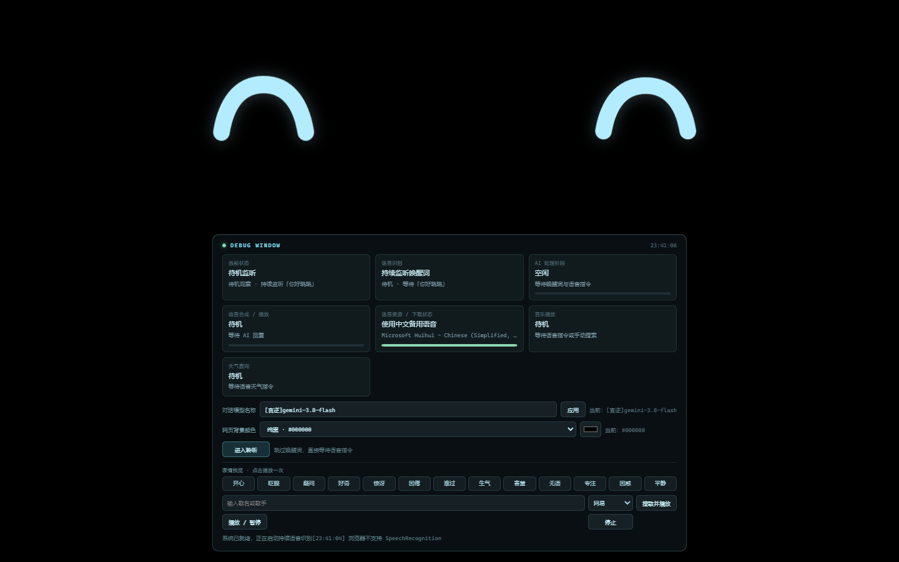 | `01-idle.png`：待机弧线眼，调试台显示持续监听 |
| 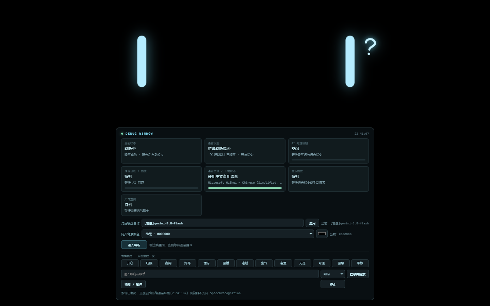 | `02-listening.png`：竖向聆听眼和右上角问号 |
| 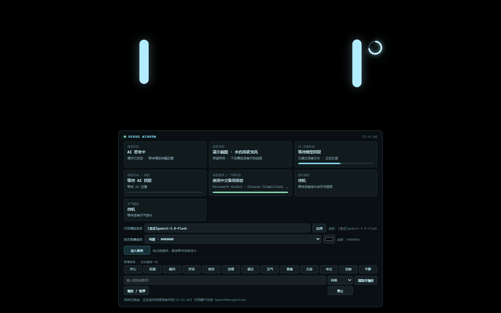 | `03-thinking.png`：思考眼和加载圆环 |
| 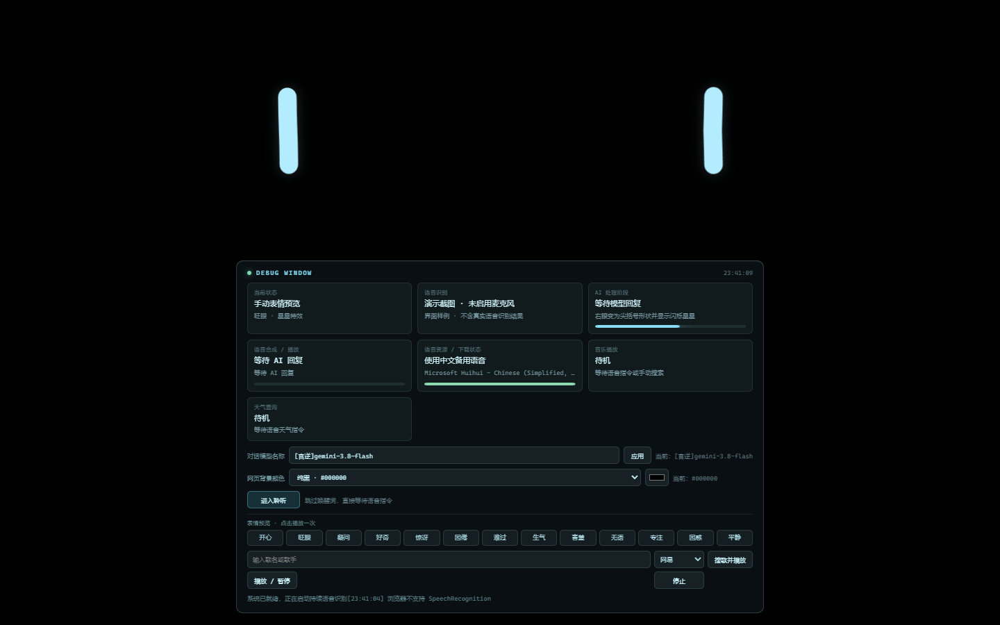 | `04-wink-stars.png`：右眼尖括号式 wink 和星星特效 |
| 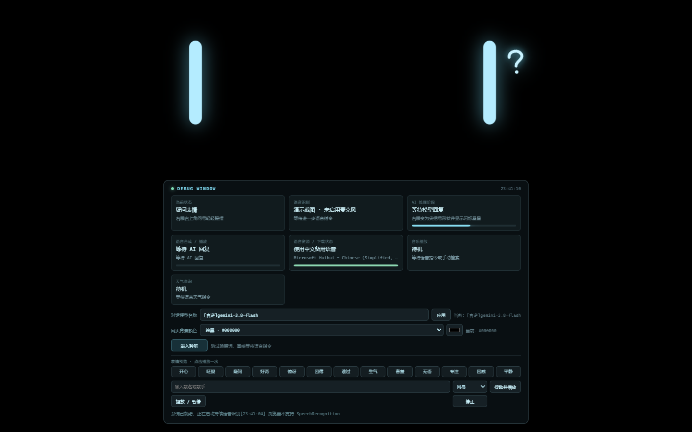 | `05-question.png`：疑问眼和摇摆问号 |

## 天气、音乐和调试台

| 文件 | 内容 |
| --- | --- |
| 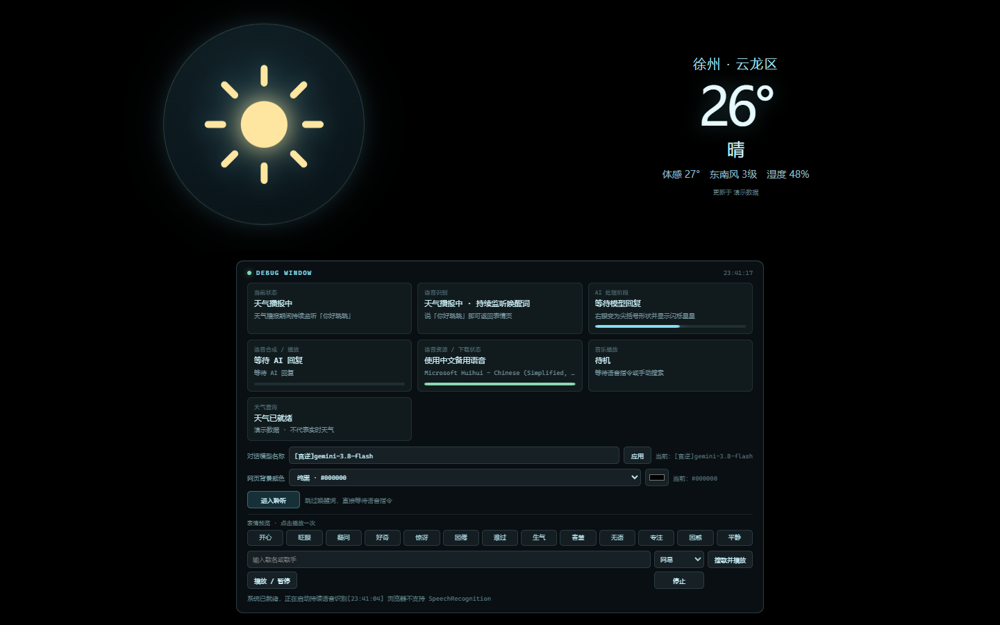 | `06-weather.png`：天气图标、温度、地点和天气调试字段 |
| 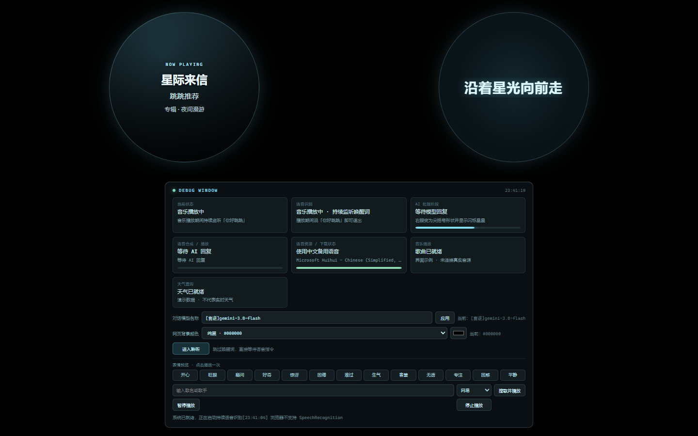 | `07-music.png`：左侧封面信息圆形区域，右侧单行歌词区域 |
| 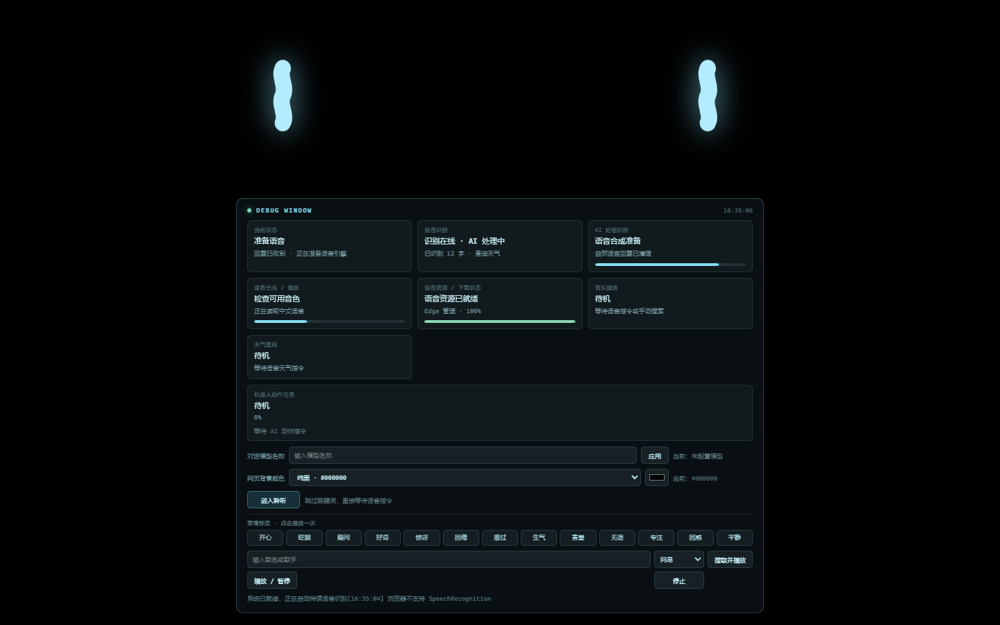 | `08-debug-panel.png`：AI、TTS、资源、模型、背景和手动控制区 |

## 更多表情

| 文件 | 表情 |
| --- | --- |
| 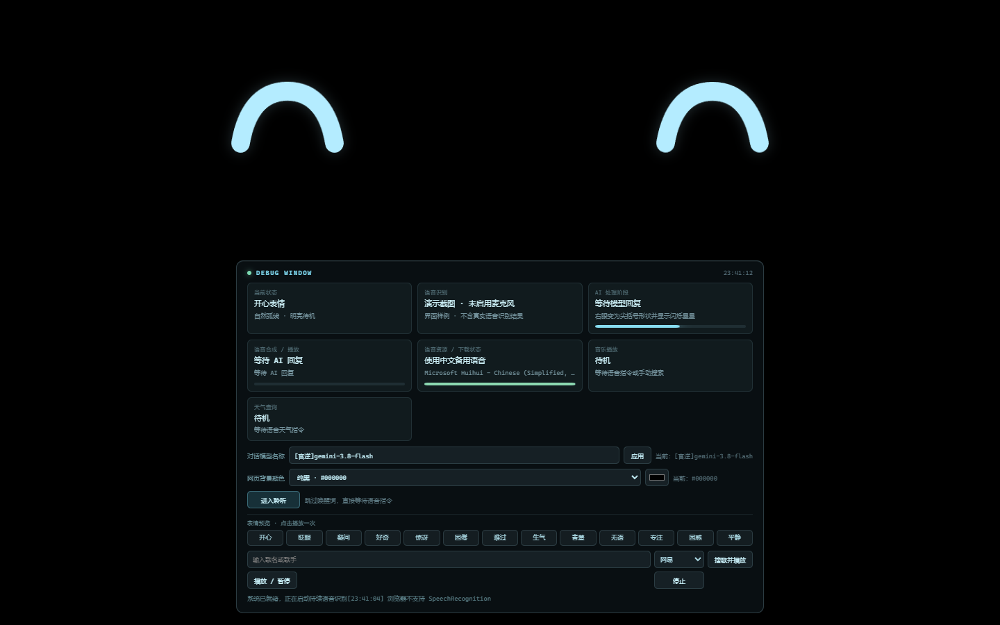 | `09-happy.png`：开心 |
|  | `10-excited.png`：兴奋 |
| 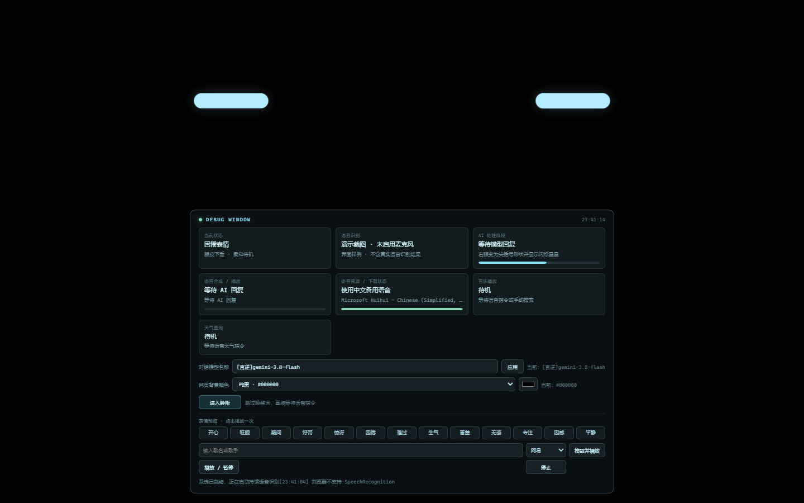 | `11-sleepy.png`：困倦 |
| 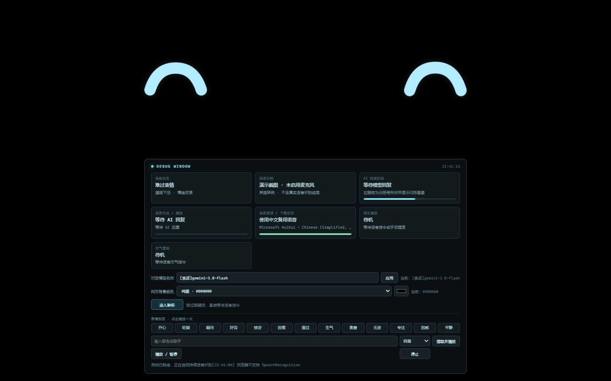 | `12-sad.png`：难过 |
| 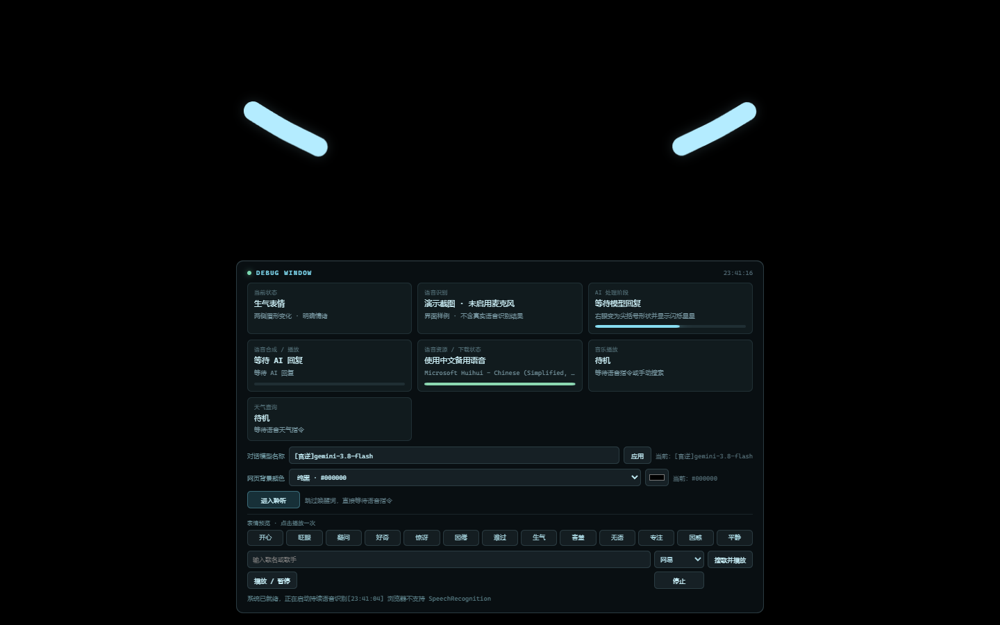 | `13-angry.png`：生气 |

## 主题和响应式

| 文件 | 内容 |
| --- | --- |
| 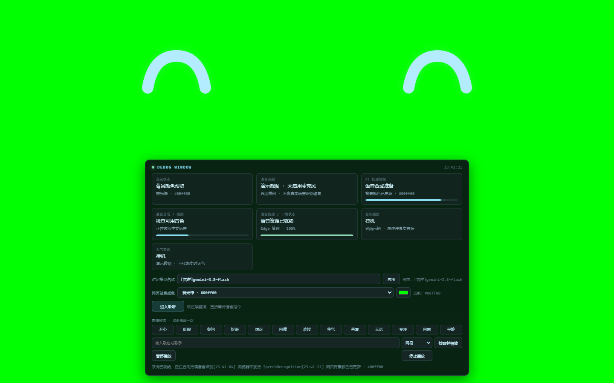 | `14-background-green.png`：`#00ff00` 背景预览 |
| 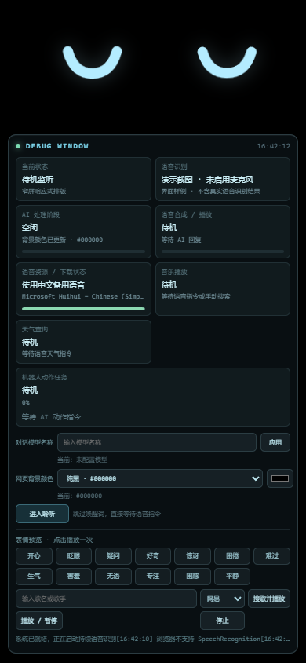 | `15-mobile-layout.png`：390×844 窄屏下的调试台和眼睛布局 |

## 如何理解截图

- 截图中的 `演示截图 · 未启用麦克风` 表示截图脚本主动禁用了 SpeechRecognition；真实运行时会显示 Edge 的识别状态。
- 天气截图中的“演示数据”只是构造的前端样例；真实运行会由 `/api/weather` 返回数据。
- 音乐截图中的“星际来信”和歌词是构造的页面样例；真实运行会使用歌曲详情接口返回的封面和 LRC。
- 截图包含调试台，便于对照代码字段；演示视频使用的是隐藏调试台的独立录制流程。
